

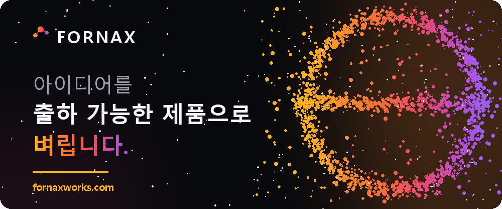

### AI とフルスタック開発。企画から本番リリースまで、一人が通しで担当します。

[https://fornaxworks.com](https://fornaxworks.com)

[한국어](README.md) | [English](README.en.md) | [中文](README.zh.md) | 日本語

 

---

## About

 
建国大学 情報通信大学院で人工知能を専攻し、修士号を取得しました。その前は中国でソフトウェア工学を4年間学び、学士論文も中国語で執筆しました。  
修士論文では RAG（検索拡張生成）のコスト問題を扱い、学士論文では Hadoop を使って電力データの使用パターンを分析しました。  
現在は <a href="https://fornaxworks.com">Fornax</a> という名前で Web、モバイル、AI プロダクトを作っています。また、2023年から留学コンサルティング事業を運営し、顧客相談から契約まで直接担当してきたため、顧客とのコミュニケーションやビジネス実務にも慣れています。  
韓国語、英語、中国語、日本語でやり取りできます。  
 

---

## Projects

 

| Project | Description | Stack |
|---|---|---|
| afterformat [afterformat.com](https://afterformat.com) | 初期化のあとに入れ直すソフトをまとめて取得できる場所。110本を韓国語・英語・日本語で扱い、個人は無料でも法人は有料というソフトを、根拠と確認日を添えて区別して表示します。winget のマニフェストを毎日走査し、新しいバージョンは人が確認するプルリクエストとして上がります。 | `Astro` `React` `Tailwind` `Cloudflare Workers` `D1` |
| project-owogg [owogg.com](https://owogg.com) | ブラウザ向けミニゲームプラットフォーム。自社ゲームとユーザー投稿ゲームを同一のランタイムで動かします。Ports/Adapters でドメインを分離し、e2e テストと staging 環境を運用しています。 | `React 19` `Hono` `Cloudflare Workers` `D1` `B2` |
| [dexon-smart-ops-chatbot](https://github.com/TaeyanG4/dexon-smart-ops-chatbot) | HDD の SMART データから7日以内に故障するディスクを予測し、点検順序・根拠文書・運用 Runbook をあわせて出します。公開前に追跡ファイル252件を全数検査し、個人情報を除去しました。 | `FastAPI` `LlamaIndex` `LiteLLM` `Langfuse` `Docker` |
| [solarops-audit](https://github.com/TaeyanG4/solarops-audit) | 運用データの品質監査パイプライン。公開されている太陽光発電データ 1,440 万行を検証し、通過した結果だけを公開します。失敗したときは前回の結果を守り、月次レポートの数字を元データまでたどれます。Compose・Airflow から Kubernetes まで、空のマシンでそのまま再現できることを自動で確認しています。 | `Python` `Airflow` `Kubernetes` `PostgreSQL` `MinIO` |
| story_maker_with_photos | 写真1枚を童話に変えるインタラクティブなストーリープラットフォーム。大学院の課題として、システム設計・UX・ビジネス戦略まで32ページの文書にまとめました。 | `GPT-4o` `DALL·E 3` `Gradio` |
| kapt_predict | 集合住宅の工事費予測モデル。自作クローラー [kapt_crawler](https://github.com/TaeyanG4/kapt_crawler) で収集した K-APT の公開データを使っています。 | `CatBoost` `pandas` |

 

---

## Datasets

 

| Dataset | Description | Scale | Repo |
|---|---|---|---|
| [Kaggle Top Solutions and Strategies](https://www.kaggle.com/datasets/taeyangg4/kaggle-top-solutions-and-strategies) | 終了した Kaggle 大会の公開解法記事を順位にかかわらず集め、各解法で使われた手法に原文リンクと順位の根拠を添えました。要約と手法の判定は、モデルが読み取った著者の主張です。 | `70,576 rows` `4 files` | [repo](https://github.com/TaeyanG4/kaggle-top-solutions-and-strategies) |
| [KONEPS Public Procurement Intelligence](https://www.kaggle.com/datasets/taeyangg4/koneps-public-procurement-intelligence) | 韓国の公共調達における入札・応札・落札・契約と関連主体を共通のキーで結びました。各段階で意味が異なるため、一つにまとめずキーと出典をそのまま保持しています。 | `8 files` `2.77 GB` | [repo](https://github.com/TaeyanG4/koneps-procurement-intelligence) |
| [South Korea Power Grid 5-Minute Data](https://www.kaggle.com/datasets/taeyangg4/south-korea-power-grid-5-minute) | 韓国電力取引所の需要予測、発電機への出力指示量、推定出力を5分間隔で整理しました。全履歴は Parquet、直近1か月は CSV で公開し、どちらもそのまま開けます。 | `1B+ rows` `2.49 GB` | [repo](https://github.com/TaeyanG4/korea-power-grid) |
| [South Korea Customs Trade 2012-2026 HSK10](https://www.kaggle.com/datasets/taeyangg4/south-korea-customs-trade-hsk10) | 韓国関税庁の輸出入実績を相手国 × 月 × 10桁の HSK 品目で整理し、上位の HS 単位は HSK10 から派生させてあわせて収録しました。 | `22.35M rows` `1.17 GB` | [repo](https://github.com/TaeyanG4/korea-customs-trade) |
| [Smithsonian 25K Museum Image-Text Dataset](https://www.kaggle.com/datasets/taeyangg4/smithsonian-25k-museum-image-text) | スミソニアン Open Access の画像と説明文を権利も確認してまとめ、同じ収蔵品が学習用と評価用の両方に含まれないように分割しました。 | `24,972 images` `916 MB` | [repo](https://github.com/TaeyanG4/smithsonian-image-text) |
| [South Korea Food-Service Permits](https://www.kaggle.com/datasets/taeyangg4/korea-food-service-permits) | 全国の一般飲食店・休憩飲食店・製菓店の現在の営業許可状況を一度に収録したスナップショットです。 | `3.01M rows` `403 MB` | [repo](https://github.com/TaeyanG4/korea-business-lifecycle) |
| [Autonomous Driving Crash Reports (NHTSA)](https://www.kaggle.com/datasets/taeyangg4/nhtsa-autonomous-driving-crashes) | 米国 NHTSA が受け取った自動運転・ADAS の事故報告を、現行の報告規定に基づいて整理しました。報告主体別の件数は、事故率や安全性の順位を示すものではありません。 | `3,263 rows` `123 cols` | [repo](https://github.com/TaeyanG4/nhtsa-autonomous-driving-crashes) |

 

---

## Showroom

 

[fornaxworks のショールーム](https://fornaxworks.com/gallery.html)に置いているデモです。実際の納品物ではなく、どこまで作るのかを示すために自分で作った見本です。 
画像をクリックするとブラウザでそのまま開きます。

<table align="center">
<tr>
<td width="33.33%" align="center" valign="top">
<a href="https://fornaxworks.com/pallet.html">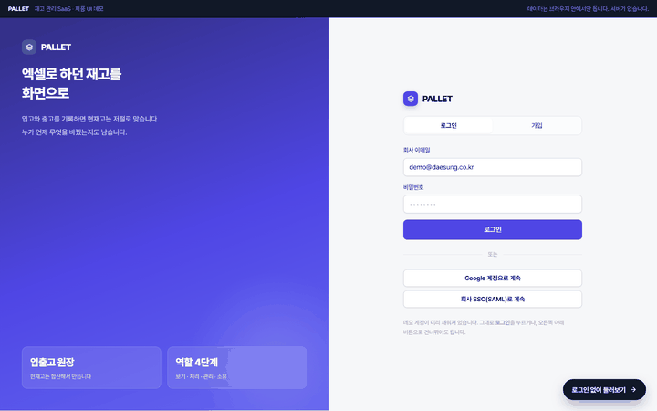</a> 
PALLET Web サービス 
登録・権限・決済まで一式 
<code>TypeScript</code> <code>Next.js</code> <code>PostgreSQL</code>
</td>
<td width="33.33%" align="center" valign="top">
<a href="https://fornaxworks.com/shop.html">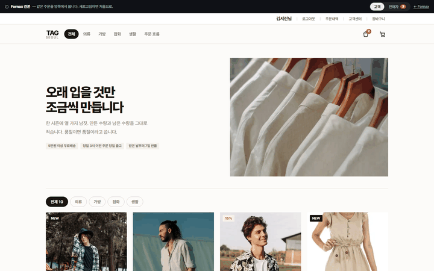</a> 
TAG EC 
キャンセル・返品・精算を状態として設計 
<code>Next.js</code> <code>PostgreSQL</code> <code>Payments</code>
</td>
<td width="33.33%" align="center" valign="top">
<a href="https://fornaxworks.com/mat.html">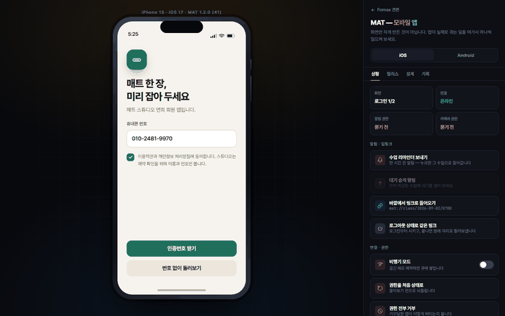</a> 
MAT モバイルアプリ 
iOS と Android を1つのコードで、 ストア審査まで 
<code>React Native</code> <code>Expo</code>
</td>
</tr>
<tr>
<td width="33.33%" align="center" valign="top">
<a href="https://fornaxworks.com/guide.html">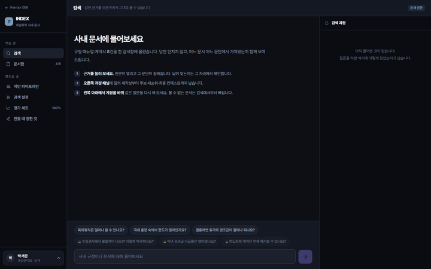</a> 
INDEX ドキュメント検索アシスタント 
ハイブリッド検索とリランキング、根拠段落の提示 
<code>Claude API</code> <code>pgvector</code> <code>FastAPI</code>
</td>
<td width="33.33%" align="center" valign="top">
<a href="https://fornaxworks.com/clerk.html">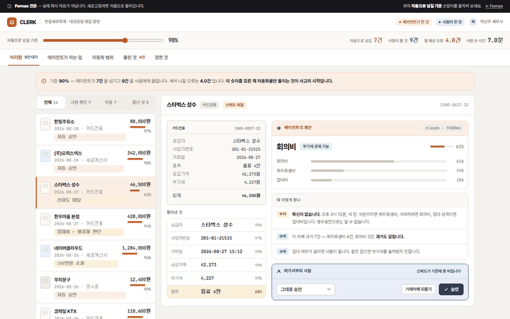</a> 
CLERK 定型業務エージェント 
ツール呼び出しパイプライン、最終承認は人が行う 
<code>Claude API</code> <code>Next.js</code>
</td>
<td width="33.33%" align="center" valign="top">
<a href="https://fornaxworks.com/board.html">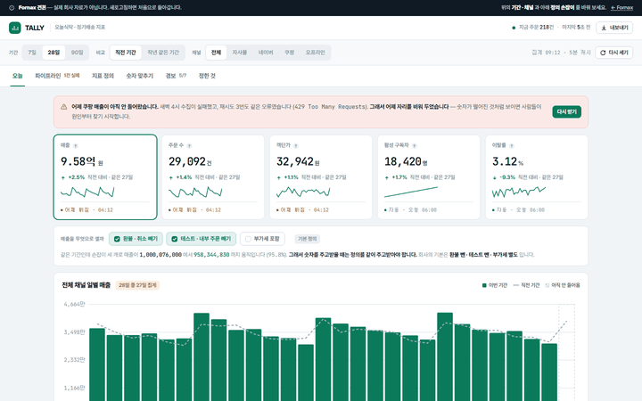</a> 
TALLY データダッシュボード 
グラフよりも、毎日自動で最新になるパイプラインが要 
<code>React</code> <code>Python</code> <code>Airflow</code>
</td>
</tr>
<tr>
<td width="33.33%" align="center" valign="top">
<a href="https://fornaxworks.com/stamp.html">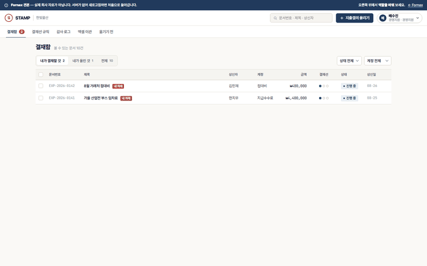</a> 
STAMP 社内業務システム 
ロール別権限と、消せない監査ログ 
<code>Remix</code> <code>Prisma</code> <code>MySQL</code>
</td>
<td width="33.33%" align="center" valign="top">
<a href="https://fornaxworks.com/bridge.html">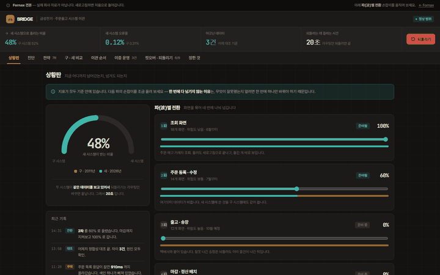</a> 
BRIDGE レガシー移行 
無停止の段階的移行と、切り戻せるデプロイ 
<code>Docker</code> <code>Terraform</code> <code>AWS</code>
</td>
<td width="33.33%" align="center" valign="top">
<a href="https://fornaxworks.com/landing.html">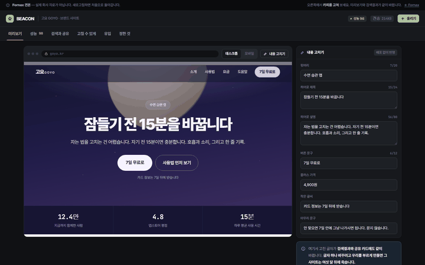</a> 
BEACON ブランド・ランディングサイト 
速度と検索性を保ち、自分で直せる状態で引き渡す 
<code>Next.js</code> <code>Vercel</code>
</td>
</tr>
<tr>
<td width="33.33%" align="center" valign="top">
<a href="https://fornaxworks.com/drive.html">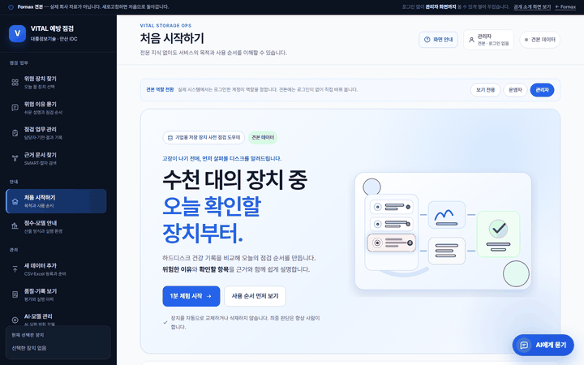</a> 
VITAL 設備の予防点検 
今日まず点検する機器を根拠とともに 
<code>FastAPI</code> <code>XGBoost</code> <code>pgvector</code>
</td>
<td width="33.33%" align="center" valign="top">
<a href="https://fornaxworks.com/crawl.html">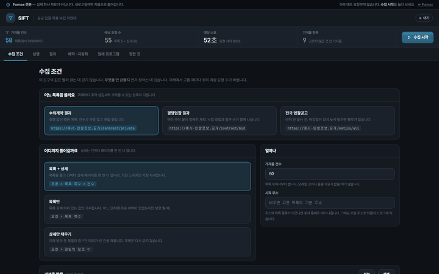</a> 
SIFT 公共データ収集ツール 
何を集めないかを先に決める収集ツール 
<code>Python</code> <code>pandas</code> <code>PyQt5</code>
</td>
<td width="33.33%" align="center" valign="top">
<a href="https://fornaxworks.com/solar.html">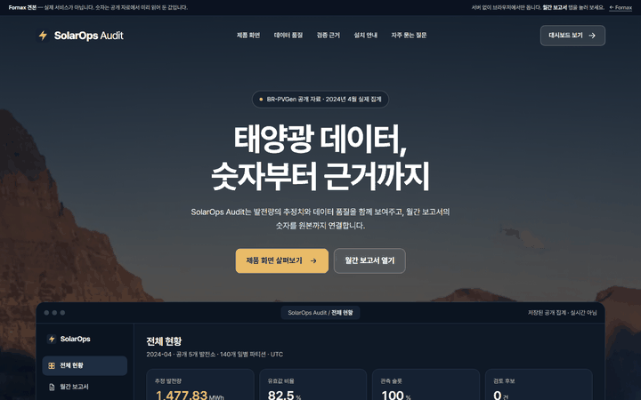</a> 
SOLAROPS 運用データ品質監査 
検証済みの結果だけを公開し、数字は元データまで 
<code>Python</code> <code>Airflow</code> <code>Kubernetes</code>
</td>
</tr>
</table>

 

---

## Research

 

### Master's Thesis

> [경량 파이프라인 컨트롤러를 통한 질의 인식 기반 비용 효율적 RAG](https://www.riss.kr/link?id=T17380351)
>
> Query-Aware Cost-Efficient RAG via a Lightweight Pipeline Controller 2026年、建国大学 情報通信大学院
>
> すべてのクエリを同じ高コストのパイプラインに通すと、簡単な質問にもコストとレイテンシがそのままかかります。 
> そこでクエリの難易度を先に見積もり、ハイブリッド検索・リランキング・HyDE を必要なときだけ有効にする軽量コントローラーを組み込みました。

### Bachelor's Thesis

> Parallelization of Data Mining in Power Industry Based on MapReduce
>
> 基于MapReduce的电力行业数据挖掘并行化实现 2020年、東北電力大学 Northeast Electric Power University
>
> スマートメーターが吐き出す使用量データは、単一のマシンでは処理しきれません。 
> 仮想マシン上に3ノードの Hadoop クラスタを構築し、MapReduce K-means で使用パターンを分類しました。

 

---

## Tech Stack

 

### Language

### AI / ML

### Backend / Frontend

### Infra / Data

### Tools

 

---

## Certifications & Education

 

<table align="center" width="100%">
<tr>
<th width="420">Data &amp; AI</th>
<th width="340">Dev &amp; Infra</th>
<th width="240">Language</th>
</tr>
<tr>
<td valign="top">

- ビッグデータ分析技士
- データアーキテクチャ準専門家 (DAsP)
- SQL 開発者 (SQLD)
- データ分析準専門家 (ADsP)
- AICE Associate
- AI-POT 1級

</td>
<td valign="top">

- 情報処理技士
- プログラミング技能士
- Linux Master 2級
- ネットワーク管理士 2級
- コンピュータ活用能力 1級

</td>
<td valign="top">

- HSK 5級

</td>
</tr>
</table>

<table align="center" width="100%">
<tr>
<th width="240">Period</th>
<th width="760">Program</th>
</tr>
<tr>
<td nowrap valign="top">2026.05 ~ 2026.08</td>
<td>

Yeardream School 第6期 応用コース 韓国中小ベンチャー企業部 AI 技術人材育成

- LLM ファインチューニング、RAG とベクトル DB
- LangChain と LangGraph、AI エージェントと MCP
- 産業連携チームプロジェクト

</td>
</tr>
<tr>
<td nowrap valign="top">2023.09 ~ 2026.02</td>
<td>

建国大学 情報通信大学院 融合情報技術学科 人工知能専攻 修士 
[成績表を見る（個人情報をマスキング済み）](assets/education/konkuk-masters-transcript-redacted.png)

</td>
</tr>
<tr>
<td nowrap valign="top">2022.10 ~ 2023.04</td>
<td>

AI Bootcamp 第16期 人工知能モデリング 6か月の学習 + 1か月の企業協業

</td>
</tr>
<tr>
<td nowrap valign="top">2014.09 ~ 2020.06</td>
<td>

東北電力大学（中国）ソフトウェア工学 学士 4年課程、在学中に兵役1年9か月

</td>
</tr>
</table>

 

---

## Algorithms

 

*Thanks BOJ Good bye BOJ*

---

## etc

 

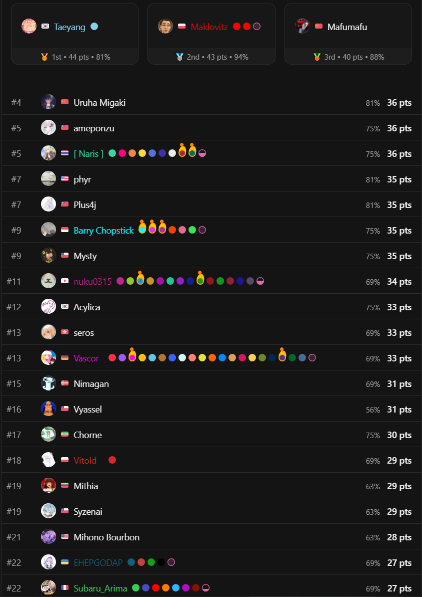

 

---

### 新規プロジェクトのご相談は [fornaxworks.com](https://fornaxworks.com) で受け付けています。

